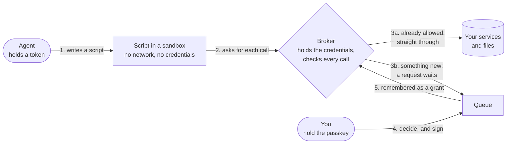

# maji-mcp

maji-mcp is a self-hosted service that gives your AI agents one careful way to reach
your services and your files. An agent writes a short script against typed functions,
the script runs in a sandbox, and the agent reads only what the script prints.
maji-mcp keeps the credentials, asks you once about each new kind of access, and
keeps the code worth using again. You run maji-mcp on your own machine, under Docker,
beside the agent's app.

## The problem

This section describes how most agents reach your services today, without maji-mcp.
The agent's app connects to an MCP server, or runs a command-line tool, for each
service, and the agent makes one call at a time. That pattern has five costs,
whichever agent and whichever services you use:

- **The model's context fills with what the model never needed to read.** A model
  pays for everything in its context on every turn, in money and in attention. In
  the usual pattern, the description of every tool is loaded before the agent
  starts, and every result comes back to the model in full. To count three hundred
  errors by cause, the model reads all three hundred. To pass one tool's output to
  the next tool, the model writes the output out again.
- **The agent holds your credentials.** For an agent to use GitHub or Sentry, you
  give the agent's app a token, or sign the app in as you. From then on the agent
  acts with your access, and the programs the agent runs can often read the token
  itself. There is no way around handing your access over. You can only trust that
  nothing misuses it.
- **Permission prompts train you to stop reading.** The agent stops to ask before
  call after call. Before long you approve each prompt as it appears, without working
  out what the call does or what you are permitting.
- **The same work is paid for again and again.** A query that took twenty careful
  calls is gone when the session ends. Unless you stop to have the agent save its
  work as functions, the next session spends the tokens again: on the calls, and on
  reasoning out which calls to make.
- **Every service is set up on its own.** Each service is another server to install
  and configure in each app. Nothing shows in one place which services your agents
  can reach, or which services a piece of work used.

## What maji-mcp does

maji-mcp sits between your agents and what the agents use, and answers each of the
five. It is early: the middle column works today, and the right column is designed
and not built.

| In place of | Works today | Planned |
|---|---|---|
| **A full context** | The work happens in code. `run_python` runs an agent's script in a fresh container, and the agent reads only what the script prints. The agent browses typed functions on demand, in place of loading every tool up front, and a script can import libraries for code, text and data. | Skills in languages other than Python |
| **Credentials in the agent's hands** | Only the broker keeps a service's key. A script has no network and no credentials, and reaches a service only by asking the broker, which checks every call against a policy and a rate limit. | OAuth sign-in, and short-lived tokens from a secret store |
| **A prompt for every call** | You are asked once for each new kind of access. The request waits in a queue while the agent carries on, and shows what is asked and what makes it risky. You decide at your own pace, signed with a passkey, and choose how long the decision is remembered. A Grants page lists what you allowed, and revokes it. | Writes that wait as changesets you review, one notification for everything waiting, rules that decide low-risk items, and risk analysis by tools such as [Corridor](https://www.corridor.dev/) |
| **Work paid for again** | Skills: an agent keeps a function it wrote and ran, and calls the function from later scripts and later sessions. You promote a skill to share it with your other agents, and demote a skill to stop it. Within a session, a script keeps a result for the scripts that follow. | Signed skills that follow you across machines, and packs of skills shared between people |
| **A setup for every service** | One catalog. An agent lists every function it may call, the web app's Connections page shows you each service and whether it is connected, and each run names the services and skills it called. Built in: Sentry, Jira and GitHub over their REST APIs; any stdio MCP server that acts as you, such as [emacs-org-mcp](https://github.com/scanner/emacs-org-mcp), through a bridge; and your repositories, log captures and data files, mounted read-only when you grant them, with files named like secrets read as empty. | Connectors you add yourself, each approved in the queue: a REST API or a database from a few lines of JSON, an MCP server, a large dataset copied into a cache, or code of your own. A page that shows everything agents can reach, and the grants that cover it. |

**Today, scripts only read.** Write access is planned, and the first work is
read-only on purpose: the patterns have to be right with reads (the sandbox, the
broker's checks, grants and the queue) before a script is allowed to change
anything. Writes will then wait in the queue as changesets you review
([docs/design/planned/writes.md](docs/design/planned/writes.md)).

The interfaces can still change. [docs/roadmap.md](docs/roadmap.md) orders the work,
and every design document says in its first lines whether it describes what is built
or what is planned ([docs/README.md](docs/README.md)).

A question that needs more than one call becomes a script:

```python
from collections import Counter

issues = sentry.issues(project="api", query="is:unresolved", period="24h")
by_culprit = Counter(issue["culprit"] for issue in issues)
print(by_culprit.most_common(5))
```

The loop over hundreds of issues happens in code, and the agent reads five lines. In
a first measurement on six real tasks, every answer was correct both ways, and
writing code cost 68% less overall: from 38% to 82% less on aggregation, joins and
multi-source procedures, and about the same on a single lookup
([docs/research/measurements.md](docs/research/measurements.md)).

## How access is asked for and granted

Agent-written code is untrusted, so the code and the credentials never share a
process. A script reaches a service only by asking the broker, and the broker decides.
A token lets an agent ask. Only your passkey decides.



- **A script is free inside what is allowed.** A call the policy allows, or a folder
  you already granted, goes straight through, as many times as the script needs.
- **Something new waits for you.** The first request for a folder, a service's key or
  a skill to share becomes an item in your queue. The agent carries on with other
  work.
- **A decision is remembered for as long as you choose:** for the session, until a
  time, or until you revoke it. The same request then goes straight through.

| Component | Job |
|---|---|
| **Gateway** | The MCP server an agent's app connects to. Identifies the caller by a token. |
| **Runner** | Starts one sandboxed container, the executor, for each script. |
| **Executor** | Runs the script. Untrusted: no network, no credentials. |
| **Broker** | Holds the credentials and calls the services. Checks every call a script makes against a policy and a rate limit. |
| **Control plane** | Holds the queue, your decisions and your passkeys, and serves the web client. |

[docs/design/architecture.md](docs/design/architecture.md) has the full diagrams.

## How it stays safe, and where it does not

maji-mcp adds a way for agents to work, and removes none: an app keeps every direct
connection the app already has. maji-mcp's boundaries protect maji-mcp's own
credentials and decisions, and limit what a script can reach.

The default deployment runs everything under your own Docker daemon. Scripts are fully
sandboxed. A program running as you, such as an agent with a shell, could still use
`docker exec` to reach the broker's credentials. Most people already give their agents
that much access, so the default favours convenience. If you want better isolation,
run the Docker daemon under another user, or run maji-mcp on another host: neither is
built into the commands yet ([docs/design/deployment.md](docs/design/deployment.md)).
[docs/design/security.md](docs/design/security.md) states each protection and each
limit.

## Supported platforms

Docker is the platform: every part of maji-mcp runs in a container, and the sandbox
is a container. maji-mcp does not run without Docker.

| | |
|---|---|
| **Supported and tested** | macOS on Apple silicon, with [Rancher Desktop](https://rancherdesktop.io) (Docker Engine 29). Agents in Claude Code and Claude Desktop. The web client in Chrome, with a passkey in the system keychain. |
| **Expected to work, not tested** | Docker Desktop or Colima on macOS: the commands use the Docker CLI's current context, and `make up` reads the Docker socket's group from the socket. The web client in Safari and Firefox. Any other app that speaks MCP over HTTP with a bearer token. |
| **Not working yet** | Linux. The stack is plain Docker Compose, but the broker reaches the bridge on your machine through `host.docker.internal`, which Docker on Linux does not define by default, and `make connect-claude-desktop` knows only the macOS path of Claude Desktop's settings. Linux is planned, as a host for the stack and for continuous integration ([docs/roadmap.md](docs/roadmap.md)). |
| **Not supported** | Windows. |

To build and run you need Docker, [uv](https://docs.astral.sh/uv/) (which installs
Python 3.14 and the dependencies), and `make`. Node 22 is needed only for `make demo`
and for work on the web client: the service image builds the web client for itself.

## Getting started

Run every command from the root of the checkout.

```sh
git clone https://github.com/scanner/maji-mcp
cd maji-mcp
make up                       # build, create your secrets, start the stack, and open
                              # the setup page to register your first passkey
make connect-claude-code      # add maji-mcp to Claude Code
make connect-claude-desktop   # optional: add it to Claude Desktop, with Desktop closed
make bridge                   # optional: serve emacs-org-mcp to the broker, from a
                              # checkout at ~/src/emacs-org-mcp, in the background
make demo                     # optional: try the queue's web client on sample requests
```

Then ask the agent a question that takes many calls, and decide what reaches your
queue at `http://localhost:8767/queue`.

`make help`, or `make` on its own, lists every command.
[docs/using.md](docs/using.md) covers setup in full, every setting, and what to do
when something goes wrong.

### What each command produces, and where

Nothing is installed outside the paths in this table.

| Command | Produces | Where |
|---|---|---|
| `make up` | a Python environment, on the first run | `.venv/` in the checkout |
| | two images, `maji-service:latest` (about 230 MB) and `maji-python-runtime:latest` (about 510 MB, with the libraries scripts import) | Docker's image store |
| | your secrets: the gateway token and its hash, the bridge's token, the instance id, a token for command-line clients | `~/.config/maji-mcp/secrets/`, readable only by you |
| | one short-lived container that reads the Docker socket's group, removed as it ends | Docker |
| | four containers: `maji-gateway-1`, `maji-runner-1`, `maji-broker-1`, `maji-control-1` | Docker; ports `127.0.0.1:8765` and `127.0.0.1:8767` |
| | nine volumes: the queue's database (`maji-control-data`), the run log (`maji-run-log`), the skill library (`maji-library`), the keys you connect services with (`maji-credentials`, which only the broker mounts), and five that hold sockets | Docker's volumes |
| connecting a service in the web app | the service's key, kept by the broker alone | the `maji-credentials` volume; never in the queue's database or its backups |
| `make connect-claude-code` | one server entry named `maji` | Claude Code's settings, `~/.claude.json` |
| `make connect-claude-desktop` | one server entry named `maji` | `~/Library/Application Support/Claude/claude_desktop_config.json` |
| `make bridge` | nothing installed; one background process, with its pid and what it writes | `~/.local/state/maji-mcp/bridge-emacs-org.pid` and `.log` |
| | a registration file while the bridge runs | `~/.config/maji-mcp/servers/emacs-org.json` |
| `make demo` | the built web client, and a demo database | `web/node_modules/`, `web/dist/`, `~/.cache/maji-mcp/demo/` |
| `make backup` | one copy of the queue's database | `~/.local/share/maji-mcp/backups/` |
| `make library-use` | nothing; it prints how scripts used each runtime library, from the run log | your terminal |
| a script an agent runs | one container, removed when the script ends | Docker |

maji-mcp reads one file of yours and never writes it:
`~/.config/maji-mcp/never-mount`, your list of paths no script may read. Each
container's log is kept by Docker, and `make logs` shows it.

To remove maji-mcp: `make down`, then remove the `maji-*` volumes and the two images
with Docker, delete `~/.config/maji-mcp/`, `~/.cache/maji-mcp/`,
`~/.local/state/maji-mcp/` and `~/.local/share/maji-mcp/`, and remove the `maji`
entry from each app.

### Running what was built

| To run | Command, from the checkout's root | Reads | Credentials |
|---|---|---|---|
| The stack | `make up`, and `make down` to stop it | `compose.yaml`, `config/policy.json`, `config/servers.json` | the files in `~/.config/maji-mcp/secrets/`, which `make up` creates. Keys for the services scripts call (Sentry, Jira, GitHub) are pasted into the web app, under Connections. |
| The queue | open `http://localhost:8767/queue` | | your passkey |
| An agent in Claude Code | `make connect-claude-code`, then start Claude Code | `bin/maji-headers` | the gateway token, read from `~/.config/maji-mcp/secrets/claude-code.token` each time Claude Code connects |
| An agent in Claude Desktop | `make connect-claude-desktop`, then open Claude Desktop, which starts `.venv/bin/maji-relay` | | the same token file, read for each request |
| An agent in another app | point the app at `http://127.0.0.1:8765/mcp` | | the same token, sent as `Authorization: Bearer <token>` |
| The bridge to emacs-org-mcp | `make bridge`, which starts `.venv/bin/maji-bridge` in the background, in front of a checkout of [emacs-org-mcp](https://github.com/scanner/emacs-org-mcp) at `~/src/emacs-org-mcp` (`EMACS_ORG_MCP=` names another), and restarts the broker so it connects. `make bridge-stop` stops it. | your org files, through emacs-org-mcp | `~/.config/maji-mcp/secrets/emacs-org.token` |
| The demo queue | `make demo`, then open `http://localhost:8768` | `web/dist/` | a passkey of the demo's own |

The four services (`maji-gateway`, `maji-runner`, `maji-broker`, `maji-control`) are
entry points of the Python package, and Docker Compose starts each one in its
container. `make status` shows whether the four are up.

## Documentation

- [docs/README.md](docs/README.md): the index of every document
- [docs/using.md](docs/using.md): running maji-mcp
- [docs/design/architecture.md](docs/design/architecture.md): how the parts fit
- [docs/design/glossary.md](docs/design/glossary.md): the terms
- [docs/design/security.md](docs/design/security.md): the security model
- [docs/roadmap.md](docs/roadmap.md): what is built, and what comes next
- [docs/decisions.md](docs/decisions.md): why each choice was made

## Contributing

- [CONTRIBUTING.md](CONTRIBUTING.md): how to propose a change
- [docs/development.md](docs/development.md): building, testing and debugging
- [AGENTS.md](AGENTS.md): the rules for code, tests and documents, for people and for
  coding agents
- [SECURITY.md](SECURITY.md): how to report a vulnerability
- [CHANGELOG.md](CHANGELOG.md): what changed in each release

## Background and license

The idea of code in place of tool calls comes from
[Cloudflare's Code Mode](https://blog.cloudflare.com/code-mode) and Anthropic's
[code execution with MCP](https://www.anthropic.com/engineering/code-execution-with-mcp).
maji-mcp is a self-hosted take on the idea, with a broker that keeps the credentials,
a library of skills, and a queue for the decisions that need a person.

The name is the Japanese *maji* (まじ), slang from *majime* (真面目, "earnest"), and
usually translated as "really" or "seriously". Asked whether you meant what you just
said, you answer "maji maji": "really, really".

maji-mcp is released under the BSD 3-Clause License ([LICENSE](LICENSE)).
