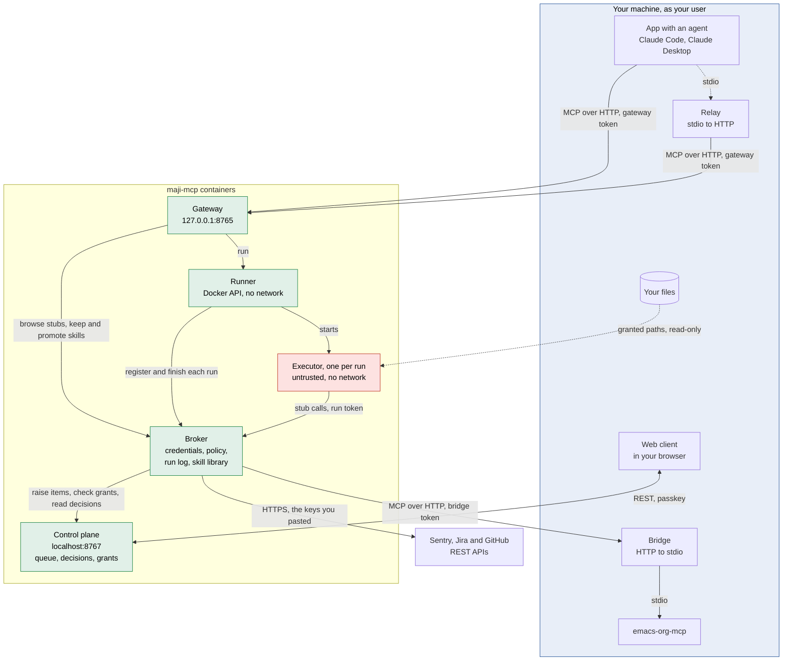
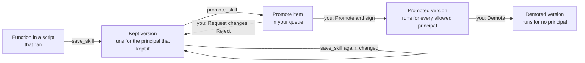

# Architecture

The components of maji-mcp, the boundaries between the components, and the path a
request takes through them.

**Status:** this document describes what is built. The last section lists what is
planned at this level. [glossary.md](glossary.md) defines every term in bold.

## The idea

An **agent** connected to several MCP servers works one tool call at a time. Every
result passes through the agent's context, often only so the agent can copy part of
the result into the next call. maji-mcp gives the agent one more tool, `run_python`.
The agent writes a short **script**. The script calls typed functions, named
**stubs**, for your **services**. The script loops, filters and joins in a sandbox,
and the agent reads only what the script prints.

Agent-written code is untrusted code. The architecture exists to let untrusted code
do useful work with your services while the code never holds a credential, never
reaches the network, and never decides anything that needs you.

## Components

| Component | Runs | Trust | Job |
|---|---|---|---|
| **Gateway** | container | trusted | The MCP server **apps** connect to. The gateway finds the **principal** from the **gateway token**, names the **session**, and offers six tools: `run_python`, `list_api`, `read_api`, `search_api`, `save_skill` and `promote_skill`. The gateway holds no credentials for services. |
| **Runner** | container | trusted | Starts one **executor** for each **run**, with the same sandbox settings every time. The runner is the only component that holds the Docker API. The runner resolves the paths a run asks to **mount**. |
| **Executor** | one container per run | **untrusted** | Runs one script. An executor has no network, no credentials and a read-only filesystem. An executor's only way out is the broker's call socket. |
| **Broker** | container | trusted | Holds the credentials and calls the services. The broker checks every stub call against the **policy** and the rate limit, keeps the **run log**, the **saved values** and the skill **library**, and raises **items** in the queue. The broker runs no agent code. |
| **Control plane** | container | trusted | Holds the **queue**, the **decisions**, the **grants** and the **passkeys** in one database. The control plane serves a REST API and the **web client** to you, and one internal socket each to the broker and the gateway. |
| **Web client** | your browser | yours | Where you read items and decide. |
| **Bridge** | your machine, as you | yours | Serves a stdio MCP server, such as emacs-org-mcp, over HTTP on `127.0.0.1` behind a token, so the broker can call the server. |
| **Relay** | your machine, as you | yours | Serves the gateway over stdio, for Claude Desktop, which starts MCP servers as commands. |

The gateway, the runner, the broker and the control plane each run as one long-lived
container, all from the **service image**. Each has a document:
[gateway.md](gateway.md), [runner.md](runner.md), [broker.md](broker.md) and
[control-plane.md](control-plane.md). [skills.md](skills.md) covers the skill library,
which spans the gateway, the broker and the control plane.

## How the components connect

Every connection between two containers is a Unix socket on a named volume, carrying
JSON-RPC 2.0, one message per line (`src/maji_mcp/common/protocol.py`). The containers
that mount a volume are the only containers that can reach the socket in the volume.

| Socket | Served by | Reached by | Carries |
|---|---|---|---|
| runner socket | runner | gateway | `run`: a principal, a script, a timeout, and any paths to mount |
| broker control socket | broker | runner, gateway | the runner registers and finishes runs; the gateway browses stubs and keeps and promotes skills |
| broker call socket | broker | every executor, read-only | stub calls, each with the run token |
| control plane's broker socket | control plane | broker | raise an item, ask whether a grant covers a request, read decisions, report outcomes |
| control plane's gateway socket | control plane | no component yet | questions from agents; served, and used once the gateway has tools for it ([planned/queue.md](planned/queue.md)) |

Two ports are published, both on `127.0.0.1` only: the gateway's (8765) and the
control plane's (8767). The runner has no network at all. The broker is the only
component that calls a service.

## Trust boundaries

1. **The executor, and everything else.** A script runs with no credentials and no
   network. Every effect a script has outside the executor is a stub call, and the
   broker checks each stub call. The executor reads your files only through mounts
   you granted, read-only.
2. **A token, and a passkey.** A gateway token lets an agent run scripts and raise
   items. A token never decides an item. Every decision is signed by a passkey, or by
   a tab key a passkey certified. The control plane's internal sockets have no method
   that decides.
3. **Your operating-system user, and maji-mcp's containers.** The containers keep
   maji-mcp's credentials and decisions apart from the agent's scripts. In the default
   deployment your user owns the Docker daemon, so a program running as you, such as
   an agent with a shell, can reach into the containers with `docker exec`.
   [deployment.md](deployment.md) describes the options that close this gap.

maji-mcp adds a way for agents to work. maji-mcp removes nothing: an app keeps every
direct connection the app already has. [security.md](security.md) states what each
boundary protects and what each boundary does not.

## How the broker knows who is calling

Every executor shares the broker's call socket, and the code in an executor is
untrusted. A run therefore cannot be believed about who the run is.

1. The gateway finds the principal from the gateway token.
2. The runner, which is trusted, registers the run on the broker's control socket,
   naming the principal and the session key.
3. The broker returns a run id and a run token.
4. The runner gives the executor the run token as the executor's only secret.
5. The broker finds the run, and so the principal, from the run token on each call.
   The broker ignores any principal a call names.
6. The runner finishes the run, and the run token stops working.

The session key travels the same way. A script cannot name another session, because
the session key arrives with the run and never with a call.

## The path of a script

1. An agent calls `run_python` with a script.
2. The gateway asks the runner to run the script as the token's principal.
3. The runner registers the run with the broker, starts an executor from the
   **runtime image**, and sends the script on standard input.
4. The script calls stubs. Each call goes to the broker, which checks the policy, the
   rate limit and the arguments, calls the service, and logs the call.
5. The runner collects what the script printed, removes the executor, and finishes
   the run with the broker.
6. The gateway returns the output to the agent. The last line of the result names
   the stubs and skills the script called, taken from the run log.

A run that names paths to mount takes a longer path the first time:

1. The runner resolves each path and refuses a path that is never mounted.
2. The broker asks the control plane whether a grant covers each path.
3. For paths no grant covers, the broker raises one item, and `run_python` returns at
   once, naming the item. The script does not run.
4. You decide the item in the web client. An approval makes a grant.
5. The agent runs the same request again, and the script runs with the paths mounted.

[runner.md](runner.md) and [control-plane.md](control-plane.md) give the details.

## The life of a skill

- **Keeping a skill needs no decision.** A skill runs with the caller's permissions,
  so a kept skill gives an agent nothing a script does not.
- **Promotion is for sharing a skill with other principals, or for a skill that
  writes.** A promote item's risk follows from what the skill reaches.
- **State decides what runs.** The location of a file plays no part.

[skills.md](skills.md) gives the details.

## Where state lives

| State | Kept by | Kept in |
|---|---|---|
| Queue items, decisions, grants, passkeys, sign-ins | control plane | SQLite, volume `maji-control-data` |
| Skill library | broker | files, volume `maji-library` |
| Run log | broker | SQLite, volume `maji-run-log` |
| Keys you connected services with | broker | files, volume `maji-credentials`, which only the broker mounts ([connections.md](connections.md)) |
| Saved values, the paths each session has asked about | broker | memory, lost when the broker restarts |
| Sessions an app names, recent scripts for `save_skill` | gateway | memory, lost when the gateway restarts |
| Secrets: token hashes, the bridge token, the instance id | you | files in the secrets directory, mounted as compose secrets |

## Stopping

Each service stops by itself when its container is told to stop, well within the 10
seconds Docker allows a container before Docker kills the container. A service is the
first process in its container, and the kernel delivers a stop signal to that process
only if the process handles the signal. So each service handles SIGTERM and SIGINT
(`common/stopping.py`):

| Service | On a stop signal |
|---|---|
| broker | Ends, with its sockets and its decision feed. |
| runner | Ends every script in flight and removes its executor, finishes each run with the broker, then ends ([runner.md](runner.md)). |
| gateway | Waits up to 3 seconds for open requests, then ends. An app's open stream does not hold the gateway. |
| control plane | Ends the event streams of open tabs, waits up to 5 seconds for open requests, then ends. |
| bridge | Removes its registration file, then ends. |

A runner that crashes or is killed outright cannot do its part. A runner that starts
therefore removes the executors an earlier runner left ([runner.md](runner.md)).

## Planned at this level

- **Writes.** A write stub will record a changeset that waits in the queue, and the
  broker will apply the changeset after your decision ([planned/writes.md](planned/writes.md)).
  Today the broker refuses every write stub.
- **Connections over OAuth.** The broker will sign in to remote MCP servers, such as
  Sentry's and Atlassian's, through the queue ([planned/connections.md](planned/connections.md)).
  Keys for services that take an API key are built ([connections.md](connections.md)).
- **More kinds of item, and help deciding.** Questions from agents, an advisor agent,
  and policy rules ([planned/queue.md](planned/queue.md)).
- **Signatures, sync and packs.** Skills shared across your machines and between
  personas ([planned/sharing.md](planned/sharing.md)).
- **More runtimes, and your live Emacs.** Skills in other languages
  ([planned/languages.md](planned/languages.md)) and Emacs Lisp
  ([planned/emacs-lisp.md](planned/emacs-lisp.md)).

[../roadmap.md](../roadmap.md) orders the planned work.
