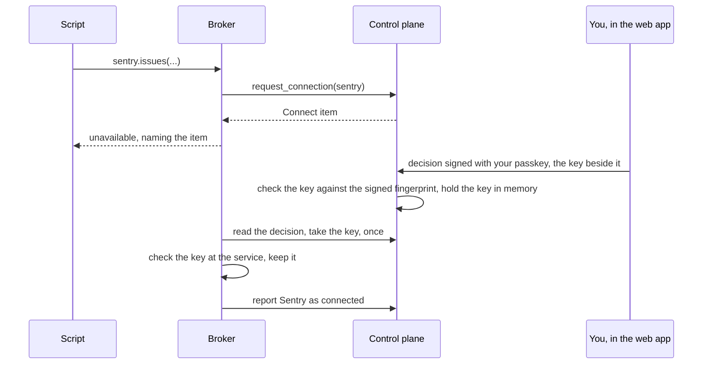

# Connections

How maji-mcp holds its own key for a service that scripts call, such as Sentry. A
**connection** is maji-mcp's own credential for one service. You paste the key into
the web app; only the broker keeps it.

**Status:** built for services that take an API key: Sentry, Jira and GitHub. Signing
in to remote MCP servers with OAuth is planned ([planned/connections.md](planned/connections.md)).

## Why maji-mcp holds its own keys

A script calls a service through the broker's stubs, and the broker makes the
request with maji-mcp's own key. The key never enters the sandbox, so a script cannot
send the key anywhere. An agent's app has its own credentials, such as Claude's
connectors, which sign in through Claude; a script cannot use those.

## A service

The broker defines each service it can call with a key (`broker/connections.py`,
`Service`; `Service` in the contract):

| Field | Meaning |
|---|---|
| `host` | The only host the key is sent to. It comes from the broker's configuration, such as `SENTRY_URL`, never from a form. |
| `sent_as` | How each request carries the key, such as `Authorization: Bearer`. |
| `permissions` | What the key must be allowed, in the service's own terms. |
| `key_page` | Where you make a key at the service. |
| `settings` | What is given with the key, none of it secret, such as Sentry's organization slug. Each has a pattern the value must match. |

The broker reports its services to the control plane, with the connection it holds
for each: as soon as the control plane answers, after every change, and every minute,
so a control plane that starts later, restarts or is restored from a backup learns
them too. The web app's Connections page lists them, and the control plane builds each
Connect item from the broker's definition.

## Connecting a service

1. **A stub needs a key the broker doesn't hold.** The broker asks the control plane
   for the service's Connect item, and the call fails at once as `unavailable`,
   naming the item. The agent carries on with other work and calls again later. A
   script that loops raises one item: the broker remembers the item for 30 seconds,
   and the control plane keeps one Connect item waiting for a service at most. You can
   also connect a service ahead of time from the Connections page, which raises the
   same item.
2. **You open the item.** It says where the key goes, how it is sent, what it must be
   allowed, and where to make one. You paste the key and the settings into the form.
3. **You sign with your passkey.** Connecting always takes a touch of its own, even in
   an unlocked tab, and is never part of a batch. The decision you sign names the key's
   fingerprint (its SHA-256, made in the browser) and the settings. The key goes beside
   the decision in the request's `secrets`, never inside it.
4. **The control plane checks the key and holds it.** The key's SHA-256 must equal the
   fingerprint you signed. The control plane records the decision without the key,
   and holds the key in memory for the broker for 10 minutes at most
   (`control/handoff.py`).
5. **The broker takes the key, once.** The broker reads the decision from the decision
   feed, takes the key from the control plane's socket, and checks the key is the one
   whose fingerprint you signed.
6. **The broker checks the key at the service.** The broker makes one read with the
   key, such as reading your Sentry organization. Only a key the service takes is
   kept. The broker then reports the service as connected, by the key's fingerprint.

When a step fails, the decision's outcome says why and to connect the service again:
the key never reached the broker (as when the control plane restarted in between),
the key isn't the one you signed for, or the service refused the key. If you deny the
item, the broker stops asking for that service until the broker restarts; you can
still connect it from the Connections page.

## Where a key is, and where it never is

- **In the broker's credential store,** one file for each service, in a folder only the
  broker's user can read, on the volume `maji-credentials`, which only the broker
  mounts (`broker/credentials.py`). A file is written whole and renamed into place.
- **In the requests to the service's host,** and nowhere else the broker sends anything.
- **Briefly in the control plane's memory,** between your decision and the broker
  taking the key.
- **Never** in the control plane's database or its backups, the event stream, a REST
  answer, a decision's outcome, the run log, a log, or anything an agent or a script
  is given. Those name a key by its fingerprint. A test pastes a key through a running
  stack and looks for the key in each of these.

`make backup` copies the control plane's database, so a backup holds no keys. After
restoring a backup on a new machine, connect the services again. `make down -v`
deletes the `maji-credentials` volume with the rest.

## Replacing and disconnecting

- **Connecting a service again replaces its key.** The new Connect item says which key
  it replaces, by when that key was connected and the start of its fingerprint.
- **Disconnect** is offered on the Connect item whose key is in effect, and takes that
  key back, like demoting a skill. Disconnecting deletes the key, and stubs ask you to
  connect the service again. A Disconnect decided just before a newer key is applied
  deletes nothing, and its outcome says a later key replaced the one it was for.

## Sentry

`sentry.*` reads Sentry's REST API (`broker/sentry.py`). The key is a Sentry user auth
token that can read your organization, its projects, and their issues and events
(`org:read`, `project:read`, `event:read`). The setting is your organization's slug.
`SENTRY_URL` names the Sentry host, `https://sentry.io` by default.

Sentry stays on its REST API rather than its MCP server. A spike on 2026-11-13 compared
the two on real data: the MCP server's issue search returns 100 issues at most with no
way to the rest, counts every environment whatever the search filters on, and runs a
model on every search, taking 4 to 11 seconds a call ([../decisions.md](../decisions.md)).
Sentry's MCP server is planned as a second namespace, over OAuth, for the tools the REST
stubs don't cover.

## Jira

`jira.*` reads Jira Cloud's REST API (`broker/jira.py`). The key is a scoped Atlassian
API token: on your Atlassian account's API tokens page, create a token with scopes, for
Jira, with `read:jira-work`. The settings are your site's name, as in
`<site>.atlassian.net`, and the email of the account that made the token.

- **The key goes only to Atlassian's API gateway,** `api.atlassian.com`, where a
  scoped token has to be sent, as HTTP basic auth with the email. The broker reads the
  site's cloud id from the site's public `/_edge/tenant_info`, without the key, and
  calls the site's API on the gateway under that id.
- **A scoped token can only do what its scopes allow,** where a classic token, without
  scopes, can do anything your account can. The connection asks for a scoped one.
- **A scoped token lasts a year at most.** An expired token is refused like any other:
  the stub's error says so, and you connect Jira again with a new token.

Jira is read through its REST API, not Atlassian's MCP server. The server takes an API
token only once an administrator of your Atlassian organization turns that on, and
otherwise signs a client in with OAuth, which isn't built. Checking what a script gets
from the server is planned, for a second namespace beside these stubs
([planned/connections.md](planned/connections.md)).

## GitHub

`github.*` reads GitHub's REST API (`broker/github.py`). The key is a fine-grained
personal access token for the repositories you choose, with read access to their
metadata, contents, pull requests and issues. Nothing is given with it.
`GITHUB_API_URL` names the API: `https://api.github.com` by default, or a GitHub
Enterprise Server's `https://<host>/api/v3`.

- **An organization may have to approve a fine-grained token** before the token reads
  the organization's repositories. Until then, GitHub answers as if those repositories
  weren't there, and the stubs say `not_found`.
- **The key goes only to the configured API.** The broker follows GitHub's next-page
  links only to that host, and reports a redirect, such as GitHub gives for a renamed
  repository, as an error naming where it leads.

## Planned

- **Signing in to remote MCP servers with OAuth,** with Sentry's MCP server as a second
  namespace ([planned/connections.md](planned/connections.md)).
- **Disconnecting from the Connections page,** by service, and revoking a token at the
  provider where the provider supports that.
