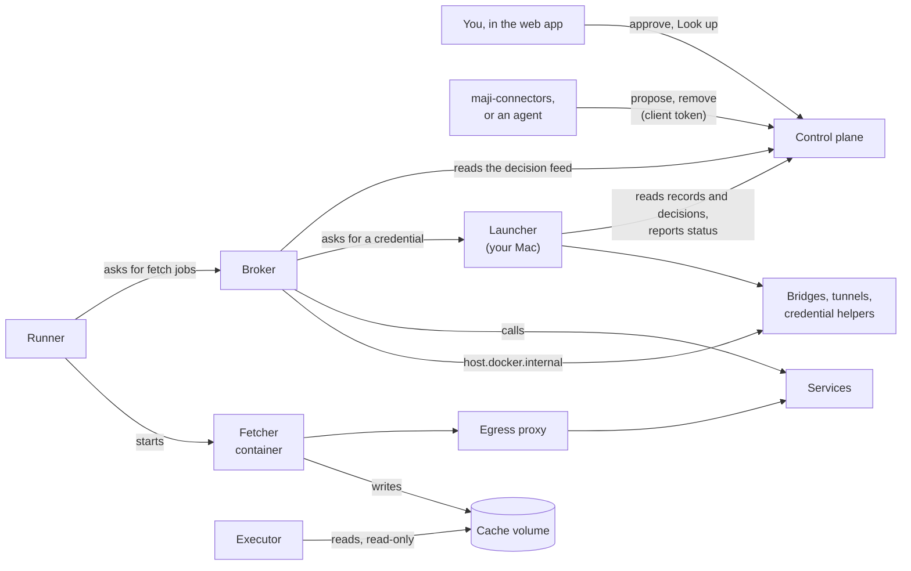
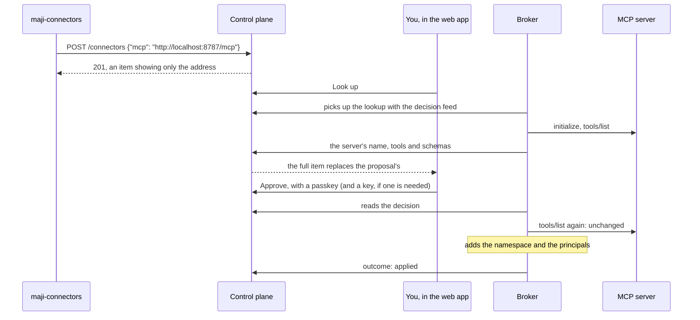

# Planned: how connectors work

The mechanics behind [adding-connectors.md](adding-connectors.md): the parts, a
connector's record, a connector's life from proposal to removal, what the broker does
on each call, fetches, the REST API, what a connector provides, what a client does,
and what protects what.

**Status:** planned. Nothing in this document is built. [adding-connectors.md](adding-connectors.md)
is the guide you follow, and this document is what makes the guide true. Connectors
reuse what is built: the queue and passkeys ([../control-plane.md](../control-plane.md)),
the decision feed and Connect items ([../connections.md](../connections.md)), MCP servers
behind the broker and the bridge ([../broker.md](../broker.md),
[../server-contract.md](../server-contract.md)), and mounts ([../runner.md](../runner.md)).

## What connectors give you

- **Reach without forking.** Scripts reach any service with no change to maji-mcp's
  code, and nothing private enters maji-mcp's repository.
- **One review point.** Whoever proposes a connector, it becomes one item that you
  approve with a passkey.
- **The guarantees built-in stubs have.** Keys never enter the sandbox, scripts only
  read, and every call passes the policy, the rate limit and the run log.
- **Joins across everything.** A script calls a connector beside Sentry, Jira, git
  history and log captures, and prints only the answer.
- **A path from a trial to a project.** A folder becomes a repository, a command on
  your Mac becomes a fetcher, and a kept skill becomes a promoted one.
- **Help writing them.** The `maji-connector` Claude Code skill writes the glue, and
  you review what it proposes.

## The parts



| Part | New or changed | What it does for connectors | Code |
|---|---|---|---|
| control plane | changed | Keeps proposals, items, decisions and removals. Serves the `/connectors` routes and the Connectors part of the Connections page. | `src/maji_mcp/control/`, `api/openapi.yaml`, `web/` |
| broker | changed | Looks up MCP servers. Adds and removes namespaces while running. Enforces each kind's rules on every call. Holds keys and queues fetches. Mounts the cache volume read-write, to move fetched files into place and evict them. | `src/maji_mcp/broker/`: a new `connectors.py`, and `catalog.py`, `policy.py`, `mcp_servers.py`, `connections.py` |
| launcher | new, on your Mac | Looks up folders, repositories and commands. Checks each approval's passkey signature. Runs commands behind bridges, keeps tunnels up, and runs credential helpers when the broker asks. | a new `launcher.py` in `src/maji_mcp/host/`, as `maji-launcher` |
| `maji-connectors` | new, on your Mac | The command line: propose, list, update, remove, export and import through the REST API; restart and logs through the launcher. | a new `connectors_cli.py` in `src/maji_mcp/host/` |
| runner | changed | Starts fetcher containers. Mounts the cache in executors. | `src/maji_mcp/runner/` |
| egress proxy | new container | The fetchers' only way out, to the hosts each job names. | a new package in `src/maji_mcp/` |
| bridge | reused | Serves a stdio MCP server over HTTP for the broker. | `src/maji_mcp/host/bridge.py` |

## A connector's record

The control plane keeps one record for each namespace, built from the proposal, the
lookup and your decision.

| Field | Meaning |
|---|---|
| `namespace` | What scripts call the connector. An identifier that is neither a built-in namespace (`maji`, `skills`, `sentry`, `jira`, `github`, `org`) nor another connector's. |
| `kind` | `mcp` (an address), `command`, `code`, `rest`, `database` or `fetcher` |
| `source` | What you gave: `{"mcp": url}`, `{"command": [...]}`, `{"folder": path}`, `{"repository": url, "ref": ref}` or `{"definition": {...}}` |
| `pins` | What approval fixed: a commit, the connector file's hash, a program's path and hash, an image's digest, the hash of the tools' schemas |
| `tools` | Each operation: the server's name, the stub's name, read or write, and its schema's hash |
| `principals` | Who may call the connector |
| `hosts` | Where requests and keys go |
| `credential` | None, a key the broker keeps, or a helper the launcher runs |
| `runs` | What the launcher runs: a bridge's command, a tunnel, helpers |
| `limits` | The rate, the response size, a database's rows and seconds, a cache's size and age |
| `state` | `proposed`, `active`, `changed` (a new item waits), `failed` or `removed` |
| `decision` | The decision that approved the current pins |

The record is derived. The control plane rebuilds it from items, decisions and
removals, so the record keeps no history of its own. The broker keeps a copy in its
volume as it applies decisions, so a restarted broker needs no control plane to serve
its connectors.

## From proposal to removal



### Proposing

- **Who proposes:** you in the web app, or anyone holding a client token: the
  command line, the REST API, the Claude Code skill. The route is `proposes`, as
  `POST /connections/{service}/requests` is.
- **What the control plane checks:** the source's form, the namespace, a folder's path
  being absolute, a URL's scheme (`https`, or `http` only to `localhost`), and a
  definition against its schema.
- **One waiting proposal for each source.** Proposing the same source again returns
  the waiting item, as a Connect item does.
- **The requester and the claim.** A proposal records who made it, `you` or
  `client:<name>`, and may carry a claim, which the item labels as the requester's
  words.

### Looking it up

| Source | Looked up by | What the lookup reads |
|---|---|---|
| `mcp` | the broker | the server's `initialize` and `tools/list` |
| `folder` | the launcher | `<folder>/maji-connector.toml`, and nothing else |
| `repository` | the launcher | `git ls-remote` for the ref, a fetch of that one commit with no checkout and no submodules, and `git show <commit>:maji-connector.toml` |
| `command` | the launcher | the program's path and hash |
| `definition` | the control plane | the definition, checked against its schema |

- **Nothing from the source runs before approval.** A lookup reads. No lookup
  installs, builds or starts anything. A `command` starts only after its first
  approval, to list its tools ([adding-connectors.md](adding-connectors.md)).
- **A lookup that contacts an address waits for you,** unless you proposed it in the
  web app. A token holder could propose any address the broker or your Mac can reach,
  including your company's hosts over the VPN, and ports on your Mac. So an `mcp`
  address or a `repository` proposed with a token raises an item with the address,
  the requester and the claim, and two actions: **Look up** and **Reject**. Look up
  is taken only from a signed-in browser, as Let it ask again is
  (`src/maji_mcp/control/api.py`, `ask_again`). A folder or a definition is looked up
  at once, since reading one named file contacts nothing.
- **A lookup request is a record of its own,** never a decision. The broker reads
  lookup requests beside the decision feed (`src/maji_mcp/control/internal.py`,
  `decisions_since`), and the launcher polls the control plane for its own. The
  lookup's result replaces the proposal's item with the full item.
- **A server that lists its tools only with a key** is approved in two steps, as a
  command is. The first item approves the address and takes the key. Once the
  broker has connected, a second item lists the tools.
- **Looking again at an approved connector doesn't wait for Look up,** such as an
  update of a repository's ref. You approved that address already.

### The item

- **The kind is `connector`.** It replaces `server_registration`, which the contract
  lists and nothing raises (`src/maji_mcp/control/store.py`, `ACTIONS`). Its actions
  are Approve and Reject, and once applied, Remove.
- **The risk is always high.** `trust_changes` is found, since agents gain reach.
  `data_leaves` is found when a key or requests go to a host no connector reached
  before. `addressed_to_ai` will be suspected over tool descriptions, once its
  detector is built. So the item takes a passkey every time and is decided alone
  ([../control-plane.md](../control-plane.md)).
- **The facts, by kind:**

  | Kind | Facts |
  |---|---|
  | every kind | the namespace, the kind, the source, the principals, the limits |
  | `mcp` | the address the broker reaches, the server's name and version, and each tool's stub name, parameters, proposed read or write, and description |
  | `rest` | the host the key goes to, how the key is sent, each method with its path prefixes, the check path |
  | `database` | the host, port, database and user, the limits, the tunnel's full command line, the password helper's full command line |
  | `command` | the full command line, every argument included, the program's path and hash, the folder it runs in, the names of the environment variables it gets; after it starts, its tools |
  | `code` | the connector file, the full command line the launcher runs, the commit, or "the code is not pinned" for a folder |
  | `fetcher` | the image, the hosts, the credential helper's full command line and what its token reads, the cache's limits, the operations and their parameters |

- **Parts:** one for each tool, `tool:<name>`, and one for each principal,
  `principal:<name>`. Refusing a tool leaves it out of the namespace, and refusing a
  principal leaves the principal out.
- **The choice may carry `connector`:** `{"namespace": ..., "classification":
  {"<tool>": "read" | "write"}}`, to rename the namespace or change a tool's
  classification. Like `credential_settings`, these are signed with the choice and
  recorded with the decision.
- **A key comes with the choice,** as a Connect item's does: the choice carries
  `credential_fingerprint` and `credential_settings`, the key travels beside the
  decision in `POST /decisions`, and the control plane holds the key in memory until
  the broker takes it (`src/maji_mcp/control/handoff.py`).

### Applying an approval

**The broker,** with an applier on the decision feed
(the new `connectors.py` beside `src/maji_mcp/broker/decisions.py`):

1. Checks the pins still hold. For an `mcp` connector, the broker lists the tools
   again and compares the schemas' hash. A difference is the outcome `conflict`, and
   raises a new item that shows the change.
2. Keeps the key, if one came.
3. Adds the namespace to the catalog, and the principals to a second policy source
   beside `config/policy.json` (`src/maji_mcp/broker/policy.py`).
4. Reports the outcome `applied`.

**The launcher,** for what runs on your Mac (`command`, `code`, and the tunnels and
helpers of `database` and `fetcher`):

1. Reads the approved records it runs, with each approving decision.
2. Checks the decision's passkey signature itself
   ([Checking a signature on your Mac](#checking-a-signature-on-your-mac)).
3. Checks the pins: the commit, the connector file's hash, the program's hash.
4. Starts what the record names. A server runs behind a bridge, whose token and
   registration (B4) go into `~/.config/maji-mcp/secrets/connectors/`, the one folder
   of the secrets directory the broker mounts.
5. Reports its status to the control plane.

The broker connects to a bridge once the bridge's registration appears. Until then,
a call returns `unavailable`, naming the launcher.

### Changes

Each pin that changes raises a new item that shows the difference:

| What changed | Noticed by | Until you approve |
|---|---|---|
| an MCP server's tools | the broker, when it connects | the unchanged tools stay callable; changed and new ones don't |
| a repository's ref | `maji-connectors update`, `POST /connectors/{namespace}/updates` | the approved commit keeps running |
| a folder's connector file | the launcher, at each start | the connector doesn't start |
| a program's hash | the launcher, at each start | the program doesn't start |
| a fetcher image's digest | the runner, at each fetch | fetches fail with `unavailable` |
| a definition | you, proposing the edited definition | the approved definition stays |

### Removal

- **Anyone who may narrow access may remove,** with no passkey: you, or a client
  token, through `DELETE /connectors/{namespace}`. Taking access away needs no proof
  that you were present (`api/openapi.yaml`, "Deciding"). In the web app, Remove is a
  reconsideration of the approval, which an unlocked tab signs.
- **A removal is a record of its own,** unsigned when made with a token. The broker
  and the launcher read removals beside the decision feed, and the decisions table
  stays as it is: signed and append-only. The broker drops the namespace, the
  policy entry and the key. The launcher stops what it ran and
  deletes the connector's tokens. A fetcher's cache is emptied.
- **What follows:** a compromised control plane can hide a removal from the broker
  and the launcher. It can't add a connector the launcher will run.

## Checking a signature on your Mac

The broker trusts the decision feed without checking signatures: the control plane
and the broker are containers of the same instance. The launcher checks, because the
launcher is the one place a decision runs a command on your Mac.

- **The launcher trusts the passkeys it sees at its first start.** On its first
  start, `make connectors` reads your passkeys' public keys from `GET /passkeys`,
  which gains a `public_key` field, and pins them. The same control plane serves the
  keys, so this is trust on first use: the first start is the anchor. A passkey
  added later is trusted only after `make connectors-trust`, which shows the new key
  and asks you in the terminal.
- **Only a passkey's own assertion counts.** A connector item is high risk, so its
  approval always carries one (`needs_passkey` in
  `src/maji_mcp/control/passkeys.py`). The launcher refuses a decision an unlocked
  tab's key signed.

For each approval, the launcher:

1. **Fetches the decision and the item it decides**
   (`GET /decisions/{decision_id}`, `GET /items/{item_id}`).
2. **Recomputes the item's content hash** from the item, leaving out the fields
   `x-maji-content-hash-excludes` lists in `api/openapi.yaml`, and checks it against
   the `content_hash` in the choice.
3. **Verifies the signature:** rebuilds the choice's canonical JSON
   (`src/maji_mcp/control/canonical.py`), checks that the choice's hash is in the
   signed batch, rebuilds the challenge from the nonce and the batch, and verifies
   the passkey's assertion against a pinned key, the origin and the relying party.
4. **Checks the action is Approve,** and that the decision is the item's latest.
5. **Runs only what the item's facts name,** as the choice changed them: its parts
   and its classification. Nothing the record adds is run.

So a compromised control plane can still approve an MCP, REST or database connector
that the broker will contact. It can't make your Mac run anything, unless it was
compromised before the launcher's first start, when it could have planted a key of
its own.

## What the broker does on each call

| Kind | Stubs | What the broker checks and does |
|---|---|---|
| `mcp`, `command`, `code` | one for each approved read tool, `<namespace>.<tool>`. A prefix every tool shares, such as `<namespace>_`, is dropped, and other characters become `_`. | Parameters come from the tool's `inputSchema`; a type the catalog lacks becomes `Any`, and the server checks it. One MCP session for each call. `_meta` carries the principal and run (A8). An address on your Mac gets `Host: localhost:<port>`. Structured content returns as records, other content as its text. An error with A2's structure raises its code; any other error raises `unavailable`. |
| `rest` | `<namespace>.get(path, params=None)`, and `post(path, body)` when the definition lists a POST | The method and path prefix must be in `read`. A full URL must be on the definition's origin. The broker adds the key, follows no redirect, and removes the key from what comes back. A status other than 2xx raises the code for the status, with the status and body in `data`. The headers kept are `link`, `content-type`, `etag`, `retry-after` and `x-ratelimit-*`. |
| `database` | `<namespace>.query(sql, params=None)`, `tables(schema=None)`, `columns(table)` | Each query runs in a read-only transaction with the time limit. Rows are fetched to one past the row limit, and one past raises `invalid_argument`. Values become JSON. The password is the kept key, or comes from the launcher's credential endpoint and is kept until near its expiry. |
| `fetcher` | one for each operation, `<namespace>.<operation>(...)` | See [Fetches](#fetches). |

- **Every call passes the checks every stub passes:** the policy, the rate limit for
  each principal and namespace, and the run log ([../broker.md](../broker.md)).
- **No response is larger than `MAX_MESSAGE`,** 16 MB
  (`src/maji_mcp/common/protocol.py`). A larger one raises, and is never cut short.
- **Tool descriptions are the server's words.** `read_api` shows a connector's
  descriptions under a line that says whose words they are.

## The launcher's credential endpoint

- **The broker asks when it needs a credential:** `POST /credentials/<namespace>` on
  the launcher's port, which the broker reaches at `host.docker.internal`.
- **Only the broker holds the endpoint's token.** Any container with network can reach
  your Mac's loopback ([../deployment.md](../deployment.md)). The token is in the
  connectors folder only the broker mounts.
- **The launcher runs the record's helper and nothing else.** The request names a
  namespace, never a command. The launcher runs the helper the approved record names,
  and returns what the helper prints.
- **On demand, not ahead of time,** so no live token waits on disk for a fetch that
  may never come.

## Fetches

```mermaid
sequenceDiagram
    participant X as Script
    participant B as Broker
    participant L as Launcher
    participant R as Runner
    participant F as Fetcher container

    X->>B: archive.readings(station, months)
    B->>L: POST /credentials/archive
    L-->>B: a token narrowed to the bucket
    R->>B: the next fetch job?
    B-->>R: the job
    R->>F: start; the request and token on standard input
    F-->>B: resolve: version 812
    B-->>F: fetch (the cache lacks it)
    F->>F: writes /cache/.incoming/<job>/
    F-->>B: the files written
    B->>B: checks them, moves them into place
    B-->>X: {"path": "/mnt/cache/archive/...", "version": 812, "bytes": ...}
```

- **The runner pulls jobs.** The runner already calls the broker over the control
  socket, and asks for fetch jobs the same way. So the broker gains no way to reach
  the Docker API. A job names only what the approved record fixes (the image's
  digest, the hosts, the namespace's folder of the cache, the limits), plus the
  call's parameters and the token.
- **The container** starts from the image's digest, as a user that isn't root, with a
  read-only root filesystem, a small `/tmp`, every capability dropped, and limits on
  memory, CPU and time. Its network is an internal network whose only way out is the
  egress proxy. Its one mount is its job's folder in the cache, read-write.
- **The token goes on standard input,** never in the environment, where
  `docker inspect` would show it.
- **Two phases in one container.** The fetcher first prints the version of what was
  asked. The broker answers `skip` when the cache has that version, and `fetch`
  otherwise. A request that names a version starts at the second phase.
- **The broker takes the result.** Only regular files inside the job's folder, within
  the cache's size, are taken. They are moved into place by renaming, so a script
  never sees half a file. The cache's index is a SQLite database in the broker's
  volume: each entry's key, version, size, and when it was made and last used.
- **Eviction** runs after each fetch and every hour: first entries older than the
  cache's age, then the least recently used beyond its size. Purging empties the
  namespace's cache.
- **Executors mount the cache** read-only at `/mnt/cache/<namespace>`, one volume
  subpath for each fetcher namespace the principal may call, from the start of the
  run. A file fetched during the run is there for the same script.
- **The egress proxy** allows a job only the hosts its record names. The internal
  network has no other route out, so a library that ignores the proxy fails rather
  than going around it.
- **The built-in fetcher** for a bucket's objects is the same mechanism with
  maji-mcp's own image. It copies objects by prefix, keyed by object and generation
  ([connections.md](connections.md)).

## The REST API

The routes join `api/openapi.yaml` under `/api/v0`. Each has an `x-maji-access`
class, which `tests/control/test_contract.py` requires of every route.

| Route | Access | What it does |
|---|---|---|
| `GET /connectors` | none | Every connector's record and state, with the launcher's last report. |
| `POST /connectors` | proposes | A proposal: one source, and optionally `namespace`, `principals` and `claim`. 201 with the item, or 200 with the item already waiting for the same source. |
| `GET /connectors/{namespace}` | none | One record, with its items and decisions. |
| `POST /connectors/{namespace}/updates` | proposes | Looks again: a repository's ref, a server's tools. 201 with an item when something changed, 204 when nothing did. |
| `DELETE /connectors/{namespace}` | narrows | Removes the connector. |
| `DELETE /connectors/{namespace}/cache` | narrows | Empties a fetcher's cache. |
| `POST /items/{item_id}/lookup` | none | Looks up a proposal's address. A signed-in browser only. |
| `PUT /connectors/{namespace}/status` | none | The launcher's report: running, stopped or failed, with a short reason. Shown, and never used to decide anything. |
| `GET /exports/connectors` | none | Every record as `connectors.json`, with no keys. |

Changes to what is there:
- **`ItemKind`:** `connector` replaces `server_registration`.
- **`DecisionChoice`:** gains `connector`, and parts named `tool:<name>` and
  `principal:<name>`.
- **`Passkey`:** gains `public_key`, for the launcher.
- **`GET /events`:** carries the ids of connectors whose record changed.

| Caller | May |
|---|---|
| you, signed in | everything above, including Look up |
| a client token | read, propose, update, remove, empty a cache, export |
| the launcher's client token | read records and decisions, report status |

## What a connector provides

### Every connector

- **A namespace, and stable operation names.** A breaking change to an operation is a
  new major version ([sharing.md](sharing.md), decision 3).
- **Reads that only read,** and every write declared as a write.

### An MCP server

[../server-contract.md](../server-contract.md) and
[server-contract.md](server-contract.md) are the full contract. A connector needs this
part of it:
- **Streamable HTTP,** or stdio behind a bridge.
- **Each tool's `inputSchema`, and `structuredContent` for records** (A1), and errors
  with A2's structure.
- **`readOnlyHint` on each read tool.** The item's proposed classification comes from
  it.
- **Requests addressed to `localhost` answered,** for a server on your Mac.
- **Capped lists that say so,** with a way to page.

### The connector file

`maji-connector.toml`, at the top of a folder or repository:

| Field | Meaning |
|---|---|
| `namespace`, `version` | What scripts call it, and its version |
| `kind` | `mcp`, the default, or `fetcher` |
| `run` | The console script that starts the server, from the project's `pyproject.toml` |
| `tools` | Each tool, as `read` or `write` |
| `env` | The names of environment variables the server gets, beside `PATH` and `HOME` |
| `image`, `hosts`, `token_from`, `cache` | A fetcher's image, hosts, credential helper and cache limits |
| `fetch.<operation>.params` | A fetcher operation's parameters and their types |

### A fetcher image

1. **Reads one JSON line on standard input:** `{"operation", "params", "token",
   "phase": "resolve"}`.
2. **Prints the version** of what was asked, as `{"version": ...}`, then reads
   `{"phase": "fetch"}` or `{"phase": "skip"}`.
3. **Writes files under `/cache`,** each holding its data.
4. **Prints what it wrote** as `{"files": [{"path", "bytes"}], "version"}`, and exits
   0.
5. **On failure, prints `{"error": {"code", "message"}}`** with one of maji-mcp's
   error codes, and exits 1. No message carries the token.

Every request goes through `HTTPS_PROXY`.

### A REST or database definition

The fields in [adding-connectors.md](adding-connectors.md). The control plane checks
a definition against a JSON Schema in `api/`.

## What a client does

### The item

[../client-rules.md](../client-rules.md) applies, and a connector item adds:
- **Facts first,** then each tool's description, labelled as the server's words, then
  the requester's claim.
- **A table of tools:** the stub's name, its parameters, a read or write switch that
  marks the server's own proposal, and the part's approve or refuse.
- **Principals as parts.**
- **A key field, as a Connect item has.** The key goes only into `POST /decisions`,
  beside the decision.
- **A change shows the difference:** tools added, removed or changed; commits and their
  diff; a program's old and new hash.
- **Always a passkey, and never a batch.**
- **A proposal waiting for Look up** shows the address, the requester and the claim,
  with Look up and Reject.

### The Connections page

- **Each service with its connectors:** the state, the last error, the launcher's
  report, and a fetcher's cache use.
- **Add a connector:** one field, with the kind it guessed shown and changeable.
- **For each connector:** Update, Remove, and Empty the cache.

### The command line

`maji-connectors` reaches the REST API with the client token for `add`, `list`,
`show`, `update`, `remove`, `purge`, `export` and `import`. It reaches the launcher
on your Mac for `new`, `restart`, `logs` and `status`.

### The Claude Code skill

- **Proposes** through the REST API with the client token.
- **Reads the item's state** to learn when you approved it, and never decides.
- **Writes skills** with `run_python` against the approved connector.
- **Lives in maji-mcp's repository,** at `claude/skills/maji-connector/SKILL.md`.

## What protects what

| Protection | Rests on |
|---|---|
| Nothing contacts a proposed address until you ask, and nothing from a source runs until you approve | A lookup of an address a token proposed waits for Look up, and lookups only read |
| No code of yours runs in the broker | Connectors run in the sandbox as skills, on your Mac through the launcher, or in a fetcher's container |
| A key goes only to its connector's host | The broker adds the key for each request, refuses other origins, and follows no redirect |
| The sandbox never sees a key or a token | As today; a fetcher's token goes only to the fetcher's standard input |
| Your Mac runs only what you signed | The launcher's own check, against passkeys it pinned |
| A fetcher reads only what its token reads, from only its hosts | The narrowed token, the egress proxy, and the internal network |
| Data at rest is bounded | The cache's size and age, and purging |
| Tool descriptions don't pass for facts | They are labelled as the server's words, after the facts |

| If this is compromised | It can | It can't |
|---|---|---|
| The control plane | approve an MCP, REST or database connector the broker will contact; hide a removal; plant a passkey, if compromised before the launcher's first start | make your Mac run anything, once the launcher has pinned your passkeys |
| The broker | call every connector's service with its keys, as today; ask the launcher for any helper's credential | start a program, or change what the launcher runs |
| A fetcher's image | read what its token reads, for the token's life; write into its job's folder | reach another host, or see your Mac |
| A connector that runs on your Mac | anything you can do: it runs as you | anything the approval didn't start |
| An agent with a shell | read the client token and propose; read the tokens in `secrets/connectors/` and call bridges or the credential endpoint, which it can already do as you | approve |

## Decisions this design makes

Beside those in [adding-connectors.md](adding-connectors.md). Each becomes an entry in
[../../decisions.md](../../decisions.md) once the design is agreed.

- **`connector` replaces `server_registration`** as the kind of item.
- **A lookup that contacts an address waits for you,** unless you proposed the
  address in the web app.
- **Removals and lookup requests are records of their own,** read beside the
  decision feed. A removal needs no signature: taking access away needs no proof of
  presence, as revoking a grant needs none.
- **The launcher checks passkey signatures itself,** and accepts only a passkey's own
  assertion.
- **The launcher trusts the passkeys the control plane reports at its first start.**
  The first start is the anchor; a later passkey takes your word in the terminal.
- **The runner pulls fetch jobs.** The broker never reaches the Docker API.
- **Credentials from helpers are made on demand,** never kept ready.

## To check before relying on it

- **Docker volume subpaths, read-only, in executors,** with Docker Engine 29.1.3, and a
  file that appears during a run.
- **A narrowed Google token made from your user credential.**
- **The egress proxy:** how a job identifies itself to the proxy, and which libraries
  honour `HTTPS_PROXY` (google-cloud-storage, gcsfs, DuckDB's `httpfs`).
- **TLS through a tunnel:** checking a database's certificate against the database's
  own name while connecting to a forwarded port.
- **How often the broker looks for changed tools,** beyond when it connects.
- **Pinning an image built on your Mac.** A local image has no registry digest, so
  the pin is the image's ID.

## Open questions

- **What becomes of `config/servers.json`, `make bridge` and the emacs-org adapter**
  ([adding-connectors.md](adding-connectors.md)).
- **How an agent without a shell proposes.** A gateway tool could carry a proposal
  over the gateway's internal socket.
- **Scoping a database to one schema at a time.**
- **Connectors in maji-mcp's own containers,** for code that needs only a pasted key.

## Building it

In order. Every test uses made-up services and data.

1. **The record, the item, and MCP addresses.** The `connector` kind, `POST`, `GET`
   and `DELETE /connectors`, Look up, the broker's lookup and applier, namespaces
   added and removed while the broker runs, the second policy source, the `Host` the
   broker sends, and the item and Connections page in the web app.
   **Done when** an MCP server on your Mac is proposed from the command line, looked
   up and approved in the web app, and called by a script with no restart; and
   removing it takes the namespace away by the next call.
   **Tests:** a fake MCP server with read and write tools, annotations, and a tool
   list that changes.
2. **REST definitions,** their stubs, and the `maji-connector` Claude Code skill.
   **Done when** a definition for a fake REST API is approved with a key, a skill
   pages through it, and a redirect, a URL on another host and an echoed key are each
   refused or removed.
3. **The launcher:** folders, repositories and commands, the signature check, bridges,
   tunnels, the credential endpoint, `make connectors` and `maji-connectors`.
   **Done when** an example connector in a folder, over a SQLite file, is approved and
   called; a decision with one byte changed is refused by the launcher; and a changed
   connector file stops the connector.
4. **Fetchers and the cache:** the runner's jobs, the container's limits, the egress
   proxy, the cache's index and eviction, the executors' mounts, `maji-gcs-token`, and
   the built-in fetcher for a bucket's objects.
   **Done when** an example fetcher writes a DuckDB file from a fake bucket, the same
   script queries the file, a request to another host fails, and eviction drops the
   oldest entry. The tests run in Docker, on `:test` images.
5. **Database definitions.**
   **Done when,** against PostgreSQL in a test container, the read-only transaction
   refuses a write, the time limit stops a long query, and a query past the row limit
   fails.
6. **OAuth sign-in** for MCP servers on the internet ([connections.md](connections.md)).
