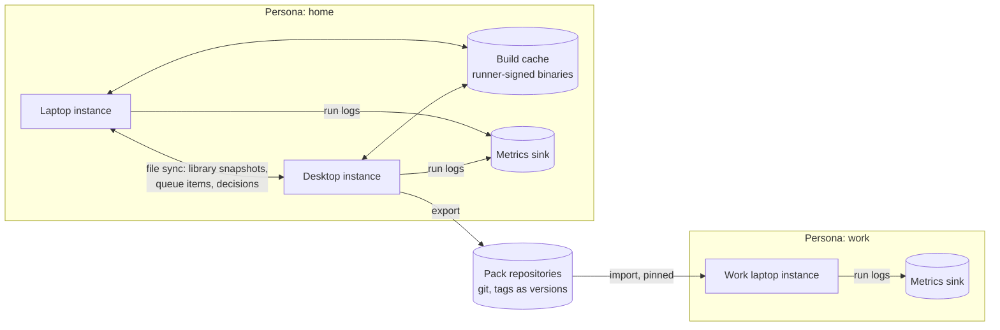

# Planned: sharing across machines and personas

How skills, the queue and configuration will move between your machines, and how a set
of skills will move between personas or people.

**Status:** planned. One instance stands alone today. The skill library already
follows some of the cheap early decisions this document asks for: decisions 1, 2, 3
and 9 below are built, and state, never location, decides what runs (decision 10,
without the signatures) ([../skills.md](../skills.md)). Signatures, sync, replication
and packs are not built.

Older text calls a kept version a *candidate*, and a script that was never kept a
*draft*. [../glossary.md](../glossary.md) gives the current terms.

## The shape of it



- **Within a persona,** file sync carries the library, the queue items and the
  decisions. Each instance runs its own control plane and owns the items it created.
- **Between personas,** packs move through git. Each pin is accepted in the receiving
  persona's queue.
- **The build cache is shared within a persona only** ([languages.md](languages.md)).
- **Each persona has its own metrics sink.** Run logs record what agents did with a
  persona's data, so run logs stay inside the persona.
- **Only packs cross between personas,** and only as source that has been through an
  export review.

## The unit of sharing: a skill pack

A **skill pack** is a versioned set of related skills, for example
`sentry-regression-triage`. Each skill is still source code in its runtime's language
plus its `SKILL.md`.
The pack adds a manifest that makes it self-describing:

```toml
[pack]
name = "sentry-regression-triage"
publisher = "me-home"
version = "1.3.0"

[requires.stubs]            # the stub APIs the code calls, and their versions
sentry = ">=2,<3"

[skills.top_frames_by_release]
runtime = "python3.14"
source = "skills/top_frames_by_release.py"
lockfile = "uv.lock"        # third-party dependencies, pinned by version and hash
input = "schemas/top_frames_by_release.in.json"
output = "schemas/top_frames_by_release.out.json"

[skills.correlate_fingerprints]
runtime = "go1.23"
source = "skills/correlate_fingerprints/"
lockfile = "skills/correlate_fingerprints/go.sum"
input = "schemas/correlate_fingerprints.in.json"
output = "schemas/correlate_fingerprints.out.json"
```

A git repository per pack, with tags as versions, is the obvious first way to
distribute packs. Nothing in the design should assume it is the only way.

A pack contains source only: the code, the manifests, the lockfiles and the tests. The
receiving instance builds any binaries itself, and rejects a pack that contains one.
Dependencies are listed in the lockfile and fetched from the receiver's own allowlist
(see [languages.md](languages.md)).

## The main case: one person, two personas

The likeliest sharer and receiver is the same person: a work persona and a personal
persona on machines that share nothing. A pack moves between them through a git remote
both can reach, such as a private repository, or as a `git bundle` file where no shared
remote is allowed. Each persona publishes under its own namespace, for example
`me-work` and `me-home`, so every skill's origin is clear.

The personas are also two data domains, so the export review below applies even
between your own machines:
- A skill written against work systems can carry internal project names, hostnames or
  example event data. These must not travel to the personal side.
- Code written for work may belong to your employer. Check that before exporting a
  work skill. Moving skills from personal to work is the simpler direction.

## Two transports: git between personas, file sync within one

**Git** suits sharing between personas, which behave like different people: updates are
explicit, pinned, reviewed and reversible.

**File sync** (Syncthing, Resilio Sync) suits one persona's own machines, which already
share directories this way. A skill promoted on one machine is live on the others
within seconds. That speed has some consequences:

- **Never sync a `.git` directory that more than one machine writes to.** File sync
  replicates files one at a time and resolves conflicts by renaming. Inside `.git` that
  corrupts the repository. Either let only one machine run git operations on the synced
  copy, or exclude `.git` with `.stignore` and keep history somewhere else.
- **Sync candidates too, but sync files, not trust.** Unpromoted candidate skills sync
  like everything else, so you can review and promote one from whichever machine you
  are at. A synced file is inert. Whether it may run is decided by its promotion record
  and each machine's run policy (see below), never by which directory it is in.
- **A multi-file update lands one file at a time.** Another machine can see a skill's
  new code before its new manifest arrives. Publish each promotion as a new snapshot
  directory, then update a `CURRENT` pointer file last. Instances load only the snapshot
  `CURRENT` names, and only when its manifest hashes match its files.
- **Concurrent edits produce conflict files** (`*.sync-conflict-*` in Syncthing). The
  loader ignores them and reports them, rather than loading either version.

Execution logs suit file sync well: each instance writes only its own files, so they
cannot conflict.

## Promotion is portable; runnability is per machine

Promoting a skill should not require going back to the machine where it was written.
So promotion state cannot depend on where the files are. It has to travel with them,
and be impossible for an agent to forge.

**A skill moves through three states:**
- **draft:** a one-shot script in a session workspace. Never synced, and runs only in
  the session that wrote it.
- **candidate:** saved for later through the broker. Synced to all of the persona's
  machines, with a record of the machine and session that wrote it.
- **promoted:** you have reviewed it and signed it.

**Promotion is a signature.** Promoting a skill signs the hash of its source, manifest
and lockfile, plus, for a runtime that builds, the digest of its build image, with one
of the persona's keys. The persona's **trust set** is its
registered public keys:
- a passkey on each of your machines, used through the control plane's clients
- optionally, an SSH signing key for `ssh-keygen -Y sign` from a CLI

Each key needs your touch to use. Every instance holds the persona's trust set and
checks the signature before it loads a promoted skill. The signature syncs with the
files, so you can promote from any machine.

The signature is needed because a state flag inside the synced files is not enough. On
your laptop, Claude Code can edit files directly with its own shell, outside maji-mcp's
sandbox. A `state = "promoted"` field in a synced file is something an agent, or a
prompt-injected instruction, could write. A signature that needs your touch is not.

**Each machine decides what it will run.** Every instance has a run policy, which lives
in instance configuration the broker owns and agents cannot write. For example:

```toml
[run_policy]
promoted = "run"                     # a valid persona signature is enough
candidate.same_machine = "run"       # candidates written on this machine
candidate.other_machine = "queue"    # each run of one written elsewhere is a queue item
draft = "session-only"
```

`queue` makes the run a queue item: `run_python` returns "queued" instead of blocking,
and the run goes ahead once you allow it. A stricter environment, such as a machine that touches production data, can set
`candidate.* = "deny"` and run only what you have signed.

So on your desktop after a trip, the laptop's candidates are already there. You can
review one and promote it on the spot, or allow a single run from the queue, without
going back to the laptop.

## Three flows

**Extract: local skills into a pack.** Pick one or more skills from your local
namespace and move them into a new or existing pack. Because this is a move, not a copy:
- the skills change namespace (`me-work/local/x` becomes
  `me-work/sentry-triage/x`)
- every local skill that calls them is updated in the same change
- anything they call that stays local either moves into the pack too or is declared as
  a dependency

Extraction ends with the export review (see Risks). Its output is a new pack version.

**Fork: copy a skill out of an imported pack and modify it.** The copy lands in your
local namespace and records where it came from:

```toml
[skill]
name = "top_frames_by_release"
derived_from = "me-home/sentry-regression-triage@1.3.0:top_frames_by_release"
```

The imported pack stays pinned and unmodified. Your fork is local code from then on, so
it does not update when the pack does. Because the record names the exact version it
copied, the service can still diff the fork against that version, and against newer
ones, to tell you when upstream has changed.

**Feedback: send a fork's improvements back.** This is deferred. The `derived_from`
record makes it possible later: the change to propose upstream is the diff between the
fork and the version it was copied from. When you own both ends, that is just a pull
request from one persona to the other's pack repository.

## Decisions to make now, to keep this open

1. **Namespace the library from day one.** Lay skills out as `<publisher>/<pack>/<skill>`,
   and put your own skills under your own namespace. Imported packs then drop in
   beside them with no name collisions and no renaming.
2. **Give every skill a manifest, local ones included.** Exporting is then just
   packaging. Retrofitting manifests onto an existing library is the expensive path.
3. **Give stub APIs stable names and versions.** A shared skill calls
   `sentry.list_events`, so that name and its signature have to mean the same thing on
   every instance. Generate the stub catalog deterministically, version each stub
   namespace, and treat a breaking signature change as a major version. On import,
   check the manifest's `requires.stubs` against the local catalog.
4. **Treat the library as a set of sources, not one repo.** There is one writable local
   source and any number of read-only sources. Each source has a transport and an update
   policy:
   - a git source pinned to a commit or tag, moved to a new pin only by accepting an
     update in the queue
   - a file-synced snapshot directory that follows its `CURRENT` pointer

   The loader works the same way for every source, so adding a transport means adding
   a source type, with no change to the executor.
5. **Keep instance-specific values out of skill code.** Project names, org directories,
   hostnames and thresholds are parameters or configuration, never constants. A skill
   hard-wired to your Sentry project names won't port.
6. **Ship tests with skills.** Use small, synthetic fixtures, so a receiver can check a
   pack against their own stub catalog before trusting it.
7. **Skills call each other by their fully namespaced name**, never by file path. That
   lets the extract flow find and update every caller, and lets a pack declare which
   skills it needs from outside itself.
8. **Record lineage in the manifest.** An optional `derived_from` field on each skill
   costs nothing now. Forking, upstream-change detection and feedback all depend on it.
9. **The publisher namespace identifies a persona.** It is set per instance by
   configuration, not hard-coded, because one person runs instances as two publishers.
10. **Trust comes from signatures, not location.** The loader decides whether a skill
    may run from its state, the persona signature on it, the absence of a signed
    revocation record, and the local run policy. The
    directory it was loaded from plays no part. Each loader trusts only its own
    persona's keys, which keeps the two personas' trust sets apart:
    - A pack from another persona is checked against that persona's signature at
      import, to establish where it came from.
    - Accepting the import in the queue signs the pinned version with your local
      persona's key. That local signature is what the loader trusts.

## One queue across your machines

Each instance runs its own control plane. Within a persona, the instances will show
one queue.

- **The instance that creates an item owns the item.** That instance is the single
  writer of the item, so items never need a central owner.
- **Items replicate.** A persona's items reach all of the persona's instances.
- **A decision can be made on any instance.** A decision is a record signed by your
  passkey. The decision replicates back to the instance that owns the item, and that
  instance's broker applies the decision. Each decision already records what is
  needed to verify it elsewhere.
- **Conflicting decisions are detected, never merged.** When two valid decisions on
  one item arrive, the owning instance applies the first and raises the second as a
  conflict item.
- **An offline instance keeps working.** An item cannot be decided on a machine that
  has not seen the item yet. That is the only cost of being offline.

## Shared configuration

A second machine should not need the setup the first machine had. Each instance stays
complete alone. The instances share the setup they have in common:

- the trust set, so a new instance needs no setup code
- policy rules, service definitions, and approved MCP servers with their tools' read
  and write classification
- grants that last until revoked, and pack pins

Credentials, run logs and each instance's own items stay with the instance, so an
approved MCP server still needs signing in to on each instance.

- **The configuration travels by any folder sync:** Syncthing, Resilio Sync, iCloud
  Drive.
- **Anything running as you, or the sync service, can edit the synced copy.** Every
  change to the copy is therefore a decision signed with a passkey, and each key in
  the trust set is signed by a key already in the set, back to the first. A new
  instance checks the chain, and anchors the chain with one touch from one of your
  keys at bring-up.
- **A Linux host cannot read iCloud.** During the host's setup, a Mac or iOS device
  hands the bundle over through the control plane's API.

Later, once file sync has given some experience of sharing: a live coordination
service a persona's instances talk to, for things like the queue.

## Building it

In order:

1. Promotion signatures the broker verifies, over the source, the manifest and the
   lockfile, checked against the persona's trust set. Signed demotions.
2. A run policy for each instance: `run`, `queue`, `deny`, `session-only`.
3. File sync within a persona: snapshot directories, a `CURRENT` pointer, conflict
   files reported.
4. Replication of items and decisions within a persona.
5. Shared configuration.
6. Packs: extract with an export review, import with a provenance check, accept and
   sign the pin, fork with `derived_from`, detect upstream changes.
7. A metrics sink for each persona.

**Done when:** a version kept on the laptop is promoted from the desktop and runs on
both, and a pack moves from home to work and runs under the work persona's signature.

## The design already covers part of this

- **Permissions stay with the receiver.** RBAC is enforced at the broker on each stub
  call. An imported skill can only declare what it needs, so it cannot carry or
  increase permissions. On the receiver's instance it runs with the receiver's
  permissions, no more.
- **Updates follow the promotion path.** A new version arrives as an import item in the
  queue, showing the diff from the pinned version. Accepting it signs the new pin with
  your local persona's key. Updates are never applied automatically to the trusted
  library. An imported pack is third-party code and gets the same review as
  a promotion, with less context about why it was written.

## Risks to design for

- **Leaking data on export.** Skill code, `SKILL.md` examples and fixtures can contain
  internal names, hostnames or real event data. Export needs a review step, and fixtures
  should be synthetic. Execution logs and session workspaces are never part of a pack.
- **Provenance.** The publisher signs each pack and the receiver signs each pin it
  accepts, so the code you reviewed is the code that runs.
- **Dependency sprawl.** Each Python package a pack needs widens the executor's
  attack surface. Limit packs to the standard library plus an approved, pinned set,
  and reject a pack that needs more until that set is changed deliberately.
